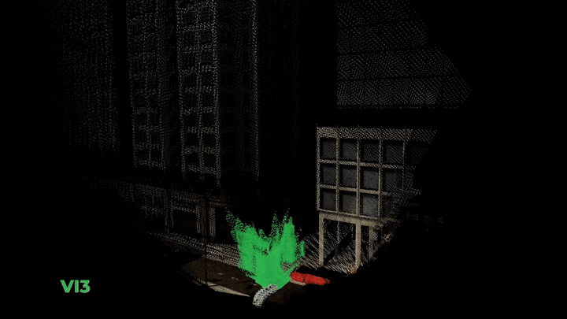

# VI3 — Grounding Pretrained 3D Foundation Models with Inertial Cues

**[Project page](https://ernestolozano.github.io/vi3/)** · **[Paper (arXiv)](https://arxiv.org/abs/2609.03824)**

<p align="center">
  
</p>

VI3 makes a **pretrained 3D foundation model** (VGGT, VGGT-Ω, Pi3, Pi3X,
DA3, Any4D, or your own one!) **metric** using **only an onboard IMU**.
It works in two blocks:

1. **IMU init** (`vi3.init`). For each window of frames, VI3 estimates the inertial state without ground truth:
   - gravity;
   - the gyro bias;
   - the metric scale of the model's trajectory;
   - the initial velocity.

   It then integrates the IMU into a metric target trajectory.
2. **Grounding** (`vi3.grounding_methods`) — use that trajectory to ground the model:

| method | what it does | use it when |
|---|---|---|
| `cfa_gyro` *(default)* | closed-form alignment: one Umeyama scale fitted to the IMU trajectory, applied to translations and depth, with rotations from the gyroscope; `cfa` applies the scale alone, keeping the model's own rotations | a fast, general-purpose default — metric pose and depth in ~1 s per window, the model's geometry kept as it is |
| `ttr` | test-time refinement of the model against the IMU trajectory, with a learnable scale | an accurate IMU trajectory: it also refines the model's geometry; 1–2 min per window |
| `cond` | the IMU trajectory fed as the model's input conditioning | models that accept poses (Pi3X, DA3, Any4D): carries the metric scale into their depth |

## Install

Tested with Python 3.10, CUDA 12.8, torch 2.11 on a single 32 GB GPU.

```bash
conda create -y -n vi3 python=3.10 && conda activate vi3

# PyTorch for your CUDA version first
pip install torch==2.11.0 torchvision==0.26.0 --index-url https://download.pytorch.org/whl/cu128

pip install -r requirements.txt
# these two over-declare deps VI3 never imports (numpy>=2, torchaudio, ...)
pip install "rerun-sdk==0.24.1" "uniception==0.1.7" --no-deps

python scripts/fetch_third_party.py      # VGGT-Ω's code (not redistributed here) into third_party/vggt-omega
pip install -e . -e third_party/vggt -e third_party/pi3 -e third_party/vggt-omega \
    --no-build-isolation --no-deps
```

Model weights download on first use, from the Hugging Face hub into its cache:
- **VGGT-Ω:** its checkpoint is gated. Request access at
  [facebook/VGGT-Omega](https://huggingface.co/facebook/VGGT-Omega), then either run
  `huggingface-cli login` (VI3 downloads it itself) or download
  `vggt_omega_1b_512.pt` and save it in `ckpt/`.
- **Local copies:** a checkpoint in `ckpt/` is used instead of downloading; `VGGT_OMEGA_CKPT` /
  `ANY4D_CKPT` can point at one elsewhere.

## Quick start

Download a dataset from its official source into `data/` (or point `EUROC_ROOT`,
`UZHFPV_ROOT`, `TARTANAIR_ROOT` at existing copies; layouts in
[`vi3/data/README.md`](vi3/data/README.md)), then run:

```bash
pip install tartanair -c requirements.txt   # keeps numpy / opencv / torch at the pinned versions
python scripts/download_data.py tartanair --sequences House/easy   # or: euroc | uzhfpv | tartanair | all
python scripts/run.py          # ground VGGT on the demo window, print the metrics
python scripts/run.py --viz    # same, and open the 3D view in Rerun
```

With no arguments, `run.py` grounds VGGT on the demo window (TartanAir
House/easy/P000, window 1) with the GT-free init and CFA+gyro. The frozen model
is at 0.28 of metric scale; grounded, it is at 1.00. The run prints a metrics
table (frozen model vs grounded) and writes `results/comparison_demo_vggt/`.
The 3D view shows the GT in its real colours, the frozen model in red and the
grounded model in green; `--viz scene.rrd` saves it to a file instead.

## Usage

```bash
# the other grounding methods, on the same demo window
python scripts/run.py --methods ttr                  # test-time refinement (~1-2 min)
python scripts/run.py --model da3 --methods cond     # pose conditioning (DA3, Pi3X, Any4D)

# whole datasets: --suite tartanair_full | euroc_full | uzhfpv_full | all
python scripts/run.py --suite euroc_full --model vggt_omega
```

`--methods` takes several at once (`cfa_gyro,ttr`, or `all`), and `--conditions`
any sequence (`--conditions MH_01_easy --window 2`).

The defaults are the paper configuration:
- `--init gt-free`;
- `--methods cfa_gyro`;
- 8-frame windows at frame stride 2, 3 windows per sequence;
- seed 42;
- TTR: 160 steps and the paper loss (`TTRGrounder.DEFAULTS` in
  [`ttr.py`](vi3/grounding_methods/ttr.py)).

`--set KEY=VALUE` overrides any method or IMU-init option, e.g. a TTR loss weight
or learning rate.

The 3 windows are the paper's evaluation windows. They are spread evenly over
10–90 % of each sequence, where the camera is in motion. `--window k` runs only
the k-th of them (0-based).

`python scripts/run.py --help` lists every option.

Each run prints the paper's metrics table, frozen model vs each method, and
saves it to `results/comparison_<name>/summary.txt`:
- **absolute**: translation and rotation error anchored at frame 0, metric depth
  AbsRel and δ<1.25, pose scale;
- **scale-invariant**: Sim(3)-aligned ATE, RPE rotation and translation direction,
  per-frame scale-aligned depth AbsRel and δ<1.25.

Values are medians over each dataset's windows, plus their mean over datasets when
there are several. `comparison.csv` next to it holds one row per window, with
`base_*` (frozen model) and `<method>_*` columns for every metric and the init's
estimates against GT (S, v0, gravity, gyro bias).

## Use the IMU init on its own

The init block needs no grounding method, e.g. to seed another VIO/Streaming/SLAM system:

```python
from vi3.data.preprocessing import prepare_batch
from vi3.init import IMUInit, resolve_preset

samples = prepare_batch(dataset, frames, "cuda")["samples"]    # one window
init = IMUInit(model, dataset, resolve_preset("gt-free"))       # model: the frozen 3DFM
targets = init.build(samples)  # metric IMU trajectory p, q (frame 0 = origin), v0, gravity
init.bg, init.diagnostics()    # gyro bias; S, v0, gravity vs GT when available
```

## Add your own 3D foundation model

Wrap the model's predictions (camera→world poses and depth) and register it:

```python
from vi3.models import register_model, square_spec
from vi3.models.foundation_model import FoundationModel, outputs_from_poses

class MyModel3D(FoundationModel):
    def __init__(self, net):
        super().__init__()
        self.net = net

    def forward(self, images):                               # [1, N, 3, H, W] in [0, 1]
        pred = self.net(images)
        return outputs_from_poses(pred["camera_poses"], pred["depth"],
                                  pred.get("intrinsics", self.cached_K), self.cached_image_hw)

register_model("my_model", lambda: square_spec("my_model"), lambda: MyModel3D(load_my_net()))
```

`python scripts/run.py --model my_module:my_model ...` then runs every method on
it. The contract, plus what TTR and conditioning additionally need, is in
[`vi3/models/README.md`](vi3/models/README.md).

## Repository

```
vi3/init/                the IMU init: IMUInit, presets, preintegration, gravity, gyro bias
vi3/grounding_methods/   closed_form.py, ttr.py, conditioning.py (shared base.py)
vi3/models/              the model contract, registry and adapters
vi3/data/                TartanAir, EuRoC MAV and UZH-FPV loaders
vi3/eval/                configuration, metrics, the per-window evaluation unit
scripts/                 run.py, download_data.py, fetch_third_party.py
assets/                  README figure (from the project page teaser)
data/                    the datasets (scripts/download_data.py; not tracked)
third_party/             vendored models (VGGT, Pi3, Depth Anything 3, Any4D), GeoCalib; VGGT-Ω (fetched)
```

## Citation

```bibtex
@misc{lozano2026vi3groundingpretrained3d,
  title         = {VI3: Grounding Pretrained 3D Foundation Models with Inertial Cues},
  author        = {Ernesto Lozano and Alberto Jaenal and Javier Civera},
  year          = {2026},
  eprint        = {2609.03824},
  archivePrefix = {arXiv},
  primaryClass  = {cs.CV},
  url           = {https://arxiv.org/abs/2609.03824},
}
```

## License and acknowledgements

VI3 is released under the [Apache License 2.0](LICENSE), copyright 2026 Universidad de Zaragoza. The code in `third_party/` keeps its upstream license; each folder has its own `LICENSE`
(VGGT-Ω is not redistributed here: `scripts/fetch_third_party.py` downloads it from its repository):
- [VGGT](https://github.com/facebookresearch/vggt): VGGT License;
- [VGGT-Ω](https://github.com/facebookresearch/vggt-omega): FAIR Noncommercial Research License — `--model vggt_omega`
  is for noncommercial research only;
- [Pi3](https://github.com/yyfz/Pi3): BSD 3-Clause;
- [Depth Anything 3](https://github.com/ByteDance-Seed/Depth-Anything-3): Apache-2.0;
- [Any4D](https://github.com/Any-4D/Any4D): Apache-2.0;
- [GeoCalib](https://github.com/cvg/GeoCalib): Apache-2.0.

The models' weights are not part of this repository; they download from their authors' releases under those
releases' own terms.
